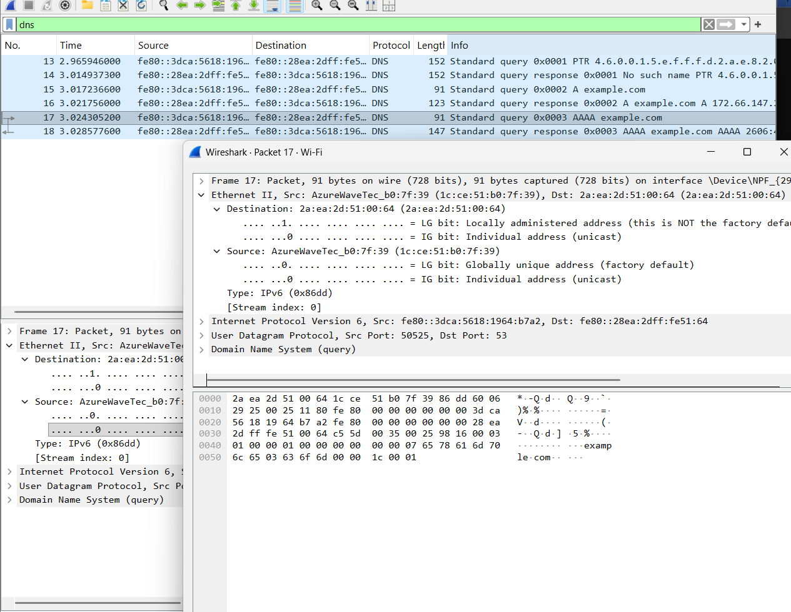

# DNS Traffic Analysis

## Objective

Analyze DNS traffic generated when resolving the domain `example.com` using Wireshark.

## Test

The following command was used to generate DNS traffic:

~~~
nslookup example.com
~~~

Wireshark was used to capture and inspect the resulting packets.

## Observations

The following display filter was used in Wireshark:

~~~
dns
~~~

The capture showed both DNS queries and responses.

Two types of DNS queries were observed:

- A record query: requests the IPv4 address of `example.com`.
- AAAA record query: requests the IPv6 address of `example.com`.

The DNS traffic was carried over UDP using destination port 53.

The capture showed:

- Packet 15: A query for `example.com`
- Packet 16: A response containing an IPv4 address
- Packet 17: AAAA query for `example.com`
- Packet 18: AAAA response containing an IPv6 address

## Security Relevance

DNS is an important part of network communication because it translates domain names into IP addresses.

Traditional DNS traffic can reveal which domains a device is attempting to resolve. This makes DNS traffic useful when investigating network activity or identifying potentially suspicious connections.

## Tools Used

- Wireshark
- Windows PowerShell
- nslookup